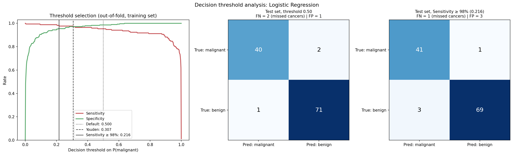
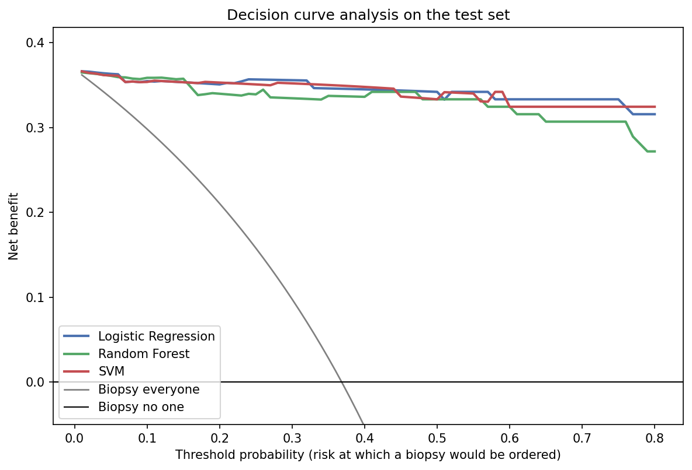
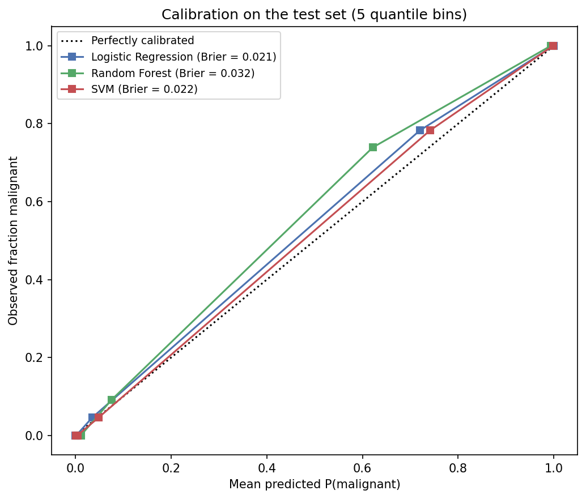
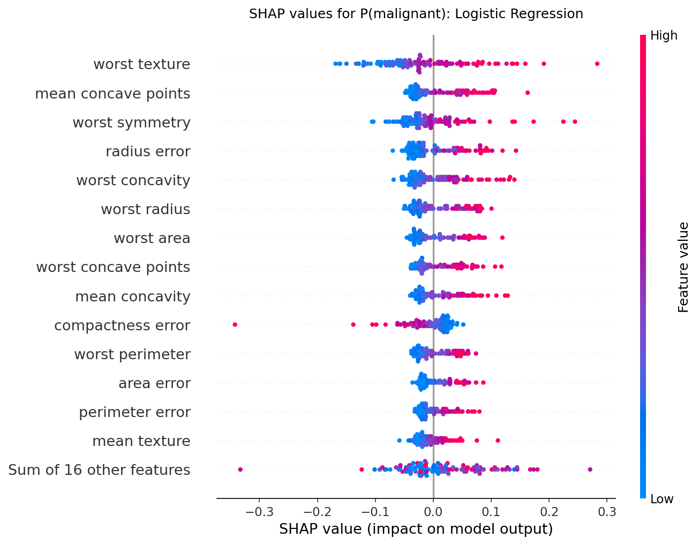

# OncoPredict-ML

[](https://github.com/felipebborges2/OncoPredict/actions/workflows/tests.yml)


Breast tumor classification (malignant vs. benign) from cytology measurements, built around a
**clinically oriented evaluation protocol**: leakage-free model selection, a pre-specified
high-sensitivity operating threshold, bootstrap confidence intervals, calibration, decision curve
analysis and SHAP explanations of the deployed model.

> **Educational and portfolio project.** Not a medical device. It does not replace professional diagnosis.

Developed by **Felipe Borges**, Medical Physics student at UFCSPA.

---

## Why this project

On the Breast Cancer Wisconsin dataset, almost any model reaches ~97% accuracy, so accuracy alone says
little. This project focuses on the questions a clinical reviewer would ask instead:

- Was the test set kept truly unseen, or was it used to pick the model or the threshold?
- How many **cancers are missed** at the chosen operating point, and how uncertain is that number?
- Are the predicted probabilities trustworthy (**calibration**)?
- Would acting on the model lead to better decisions than biopsying everyone (**decision curve analysis**)?
- Are the candidate models actually different, or is the "winner" decided by one or two patients?

## Results

Selected model: **Logistic Regression** (highest mean 5-fold CV ROC AUC on the training set).
Deployed threshold: **0.216**, the highest threshold that reached ≥ 98% sensitivity on out-of-fold
training predictions. Test set: 114 samples (42 malignant), 95% bootstrap CIs.

| Metric (test set) | Threshold 0.50 | Deployed threshold 0.216 |
|---|---|---|
| ROC AUC | 0.996 (0.986 – 1.000) | 0.996 (0.986 – 1.000) |
| Sensitivity | 95.2% (87.5% – 100%) | **97.6% (92.1% – 100%)** |
| Specificity | 98.6% (95.2% – 100%) | 95.8% (90.8% – 100%) |
| Missed cancers (FN) | 2 | **1** |
| False alarms (FP) | 1 | 3 |
| Brier score | 0.021 | 0.021 |

| Model | CV ROC AUC (mean ± sd) | Test AUC (95% CI) |
|---|---|---|
| **Logistic Regression** | **0.9959 ± 0.0046** | 0.996 (0.986 – 1.000) |
| SVM (RBF) | 0.9949 ± 0.0050 | 0.995 (0.983 – 1.000) |
| Random Forest | 0.9889 ± 0.0067 | 0.995 (0.986 – 1.000) |

**The three models are statistically indistinguishable on the test set** (overlapping CIs; pairwise
McNemar p = 1.0). Logistic Regression is kept because it ranks first in cross-validation and is the
simplest and most transparent of the three. The full, auto-generated report is in
[reports/final_report.md](reports/final_report.md).

### Threshold selection
Thresholds are chosen on out-of-fold training predictions (left) and only then applied to the test set (right).


### Decision curve analysis and calibration
All models give a higher net benefit than "biopsy everyone" or "biopsy no one" across clinically
reasonable thresholds. Linear models are well calibrated (Brier ≈ 0.02).

<p float="left">
  
  
</p>

### Explainability (SHAP on the deployed pipeline)


Size, concavity and texture features drive malignancy predictions. Several features are almost
perfectly collinear (e.g. mean radius vs. mean perimeter, r = 0.998), so per-feature attributions
should be read as evidence about *groups* of related measurements, not as causal effects. The
negative contribution of `compactness error` is a suppressor effect of this collinearity (see
notebook 02).

---

## Methodology

1. **Data.** [Breast Cancer Wisconsin (Diagnostic)](https://archive.ics.uci.edu/dataset/17/breast+cancer+wisconsin+diagnostic):
   569 fine-needle aspirate images, 30 nuclear morphology features. Labels are re-encoded so that
   **1 = malignant** (scikit-learn ships 0 = malignant), making every metric refer to cancer detection.
2. **Split.** Stratified 80/20 hold-out. The test set is used once, for final reporting.
   Exploratory analysis uses the training split only.
3. **Tuning.** `GridSearchCV` with 5-fold stratified CV per model, scoring = ROC AUC. Scaling lives
   inside each `Pipeline`, so it is fitted on training folds only.
4. **Selection.** Highest mean CV score. The test set plays no part in this decision.
5. **Operating threshold.** Out-of-fold predictions on the training set (`cross_val_predict`).
   Rule fixed in advance: highest threshold with sensitivity ≥ 98%. Youden's J is reported for reference.
6. **Evaluation.** ROC AUC, sensitivity, specificity, Brier score with 2000-resample percentile
   bootstrap CIs, exact McNemar tests, calibration curves, decision curve analysis.
7. **Explanation.** Model-agnostic SHAP permutation explainer applied to the full deployed pipeline,
   in probability units and original feature scale.
8. **Reproducibility.** Fixed seeds everywhere (including SVM Platt scaling), pinned dependencies,
   tests and CI that rerun the full pipeline on every push.

## Limitations

- Single public dataset from one institution, with no external validation.
- Small test set: sensitivity is only known to within several percentage points.
- The dataset is curated and nearly linearly separable; real clinical data are noisier.
- Not validated for clinical use.

---

## Project structure

```
OncoPredict/
├── src/
│   ├── oncopredict/
│   │   ├── config.py        # paths, seeds and protocol settings
│   │   ├── data.py          # loading (1 = malignant) and stratified split
│   │   ├── models.py        # pipelines, grids, tuning and CV-based selection
│   │   ├── evaluation.py    # thresholds, bootstrap CIs, McNemar, net benefit
│   │   ├── plots.py         # ROC, threshold, calibration, decision curve, learning curve
│   │   ├── explain.py       # SHAP for the deployed pipeline
│   │   └── report.py        # markdown report generation
│   ├── train.py             # end-to-end training and evaluation
│   └── predict.py           # CLI inference (synthetic sample or CSV)
├── tests/                   # pytest suite
├── notebooks/
│   ├── 01_exploratory_analysis.ipynb
│   └── 02_results_analysis.ipynb
├── reports/                 # final_report.md, model_comparison.csv
├── figures/
├── .github/workflows/       # CI: tests + full pipeline smoke run
├── requirements.txt         # pinned runtime dependencies
└── requirements-dev.txt     # + pytest
```

## Getting started

```bash
git clone https://github.com/felipebborges2/OncoPredict.git
cd OncoPredict
python -m venv .venv
source .venv/bin/activate          # Windows: .venv\Scripts\activate
pip install -r requirements-dev.txt
```

```bash
python src/train.py                                  # train, evaluate, write reports and figures (~20 s)
python src/predict.py                                # predict a built-in synthetic sample
python src/predict.py -i samples.csv -o preds.csv    # predict your own CSV
pytest                                               # run the test suite
```

The input CSV needs one row per sample and the 30 feature columns of the original dataset
(e.g. `mean radius`, `worst concave points`). Extra columns are ignored. Values outside the training
range are flagged as extrapolation.

## Tech stack

Python · scikit-learn · pandas · NumPy · SciPy · SHAP · matplotlib · seaborn · pytest · GitHub Actions

## References

- Street, Wolberg & Mangasarian (1993). Nuclear feature extraction for breast tumor diagnosis. *SPIE Biomedical Image Processing*.
- Vickers & Elkin (2006). Decision curve analysis: a novel method for evaluating prediction models. *Medical Decision Making*.
- Lundberg & Lee (2017). A unified approach to interpreting model predictions. *NeurIPS*.
- Collins et al. (2024). TRIPOD+AI statement. *BMJ*.

## Author

**Felipe Borges**, Medical Physics student at UFCSPA · [GitHub](https://github.com/felipebborges2)

Licensed under the [MIT License](LICENSE).
